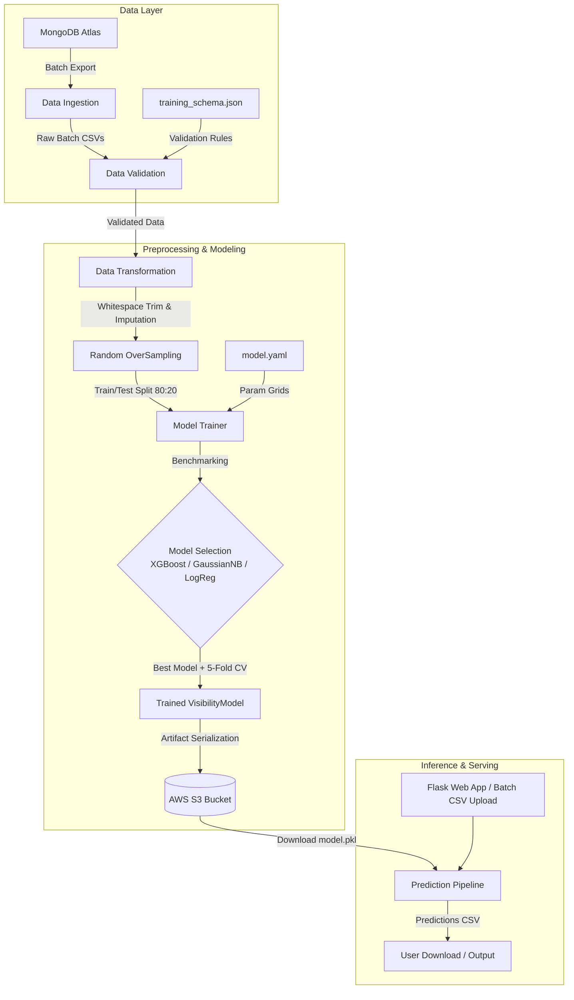

# Phishing Website Detection — End-to-End MLOps Pipeline

[](https://www.python.org/)
[](https://flask.palletsprojects.com/)
[](https://scikit-learn.org/)
[](https://xgboost.readthedocs.io/)
[](https://www.docker.com/)
[](https://aws.amazon.com/s3/)
[](https://www.mongodb.com/)

A production-ready, modular Machine Learning pipeline designed to classify websites as **legitimate** or **phishing** based on 30 heuristic and structural security features. 

The system incorporates an end-to-end MLOps lifecycle: schema-driven automated data validation, remote MongoDB Atlas data ingestion, automated class-imbalance correction, model benchmark evaluation with hyperparameter tuning (GridSearchCV), cloud-based model registry on AWS S3, and containerized batch inference served via a Flask web application and Docker.

---

## 📑 Table of Contents
- [Architecture Overview](#-architecture-overview)
- [Key Features](#-key-features)
- [Dataset & Feature Engineering](#-dataset--feature-engineering)
- [Machine Learning Workflow](#-machine-learning-workflow)
- [Project Directory Structure](#-project-directory-structure)
- [Getting Started](#-getting-started)
  - [Prerequisites](#prerequisites)
  - [Environment Variables](#environment-variables)
  - [Local Installation](#local-installation)
  - [Running with Docker](#running-with-docker)
- [Web API & Usage](#-web-api--usage)
- [MLOps Highlights & Best Practices](#-mlops-highlights--best-practices)

---

## 🏛 Architecture Overview



---

## ✨ Key Features

- **Schema-Driven Data Quality Control**: Enforces strict filename pattern matching via regular expressions, checks exact column counts (31 columns), and ensures zero fully-null columns before pipeline execution.
- **Dynamic Database Integration**: Ingests raw batch data directly from **MongoDB Atlas** clusters into isolated, timestamped feature store directories.
- **Handling Class Imbalance**: Integrates `imbalanced-learn` (`RandomOverSampler`) to handle class imbalance between malicious and benign web samples.
- **Model Benchmarking & Auto-Tuning**: Compares multiple classifiers (**XGBoost**, **Logistic Regression**, and **Gaussian Naive Bayes**) and applies 5-fold cross-validation `GridSearchCV` dynamically loaded from `config/model.yaml`.
- **Custom Model Wrapper (`VisibilityModel`)**: Bundles both data imputation objects (`SimpleImputer`) and the tuned estimator into a single serialized pickle file, eliminating training-serving skew.
- **Cloud Model Registry (AWS S3)**: Automatically versions and pushes production-grade models to AWS S3, and fetches them on demand during inference.
- **Batch Prediction Web Interface**: Interactive Flask UI supporting batch CSV file uploads, automatic scoring, and one-click downloading of classified results.
- **Containerized & Modular**: Built strictly using Object-Oriented Principles (OOP), complete with custom logging, custom exception handling (with script and line number tracking), `setup.py` packaging, and a lightweight `Dockerfile`.

---

## 📊 Dataset & Feature Engineering

The project is trained on the benchmark **UCI Phishing Websites Dataset** containing **11,055 instances** across **30 security attributes** and 1 target label:
- **Target Variable (`Result`)**:
  - `1`: Legitimate / Safe website
  - `-1` (Mapped to `0`): Phishing website

### Categorized Security Attributes
1. **URL & Address Bar Features**:
   - `having_IP_Address`: Checks if an IP address is used instead of a domain name.
   - `URL_Length`: Flags excessively long URLs designed to hide page targets.
   - `Shortining_Service`: Identifies URL shorteners (e.g., bit.ly, tinyurl).
   - `having_At_Symbol`: Checks for "@" symbols used to ignore leading strings.
   - `double_slash_redirecting`: Detects `//` redirects within the path.
   - `Prefix_Suffix`: Detects hyphens added to domain names (e.g., `paypal-verify.com`).
   - `having_Sub_Domain`: Evaluates multi-level subdomains.
   - `SSLfinal_State`: Evaluates HTTPS validity, certificate age, and trusted issuers.
   - `HTTPS_token`: Detects fake "https" strings injected into domain names.
2. **Abnormal & Anchor Features**:
   - `Request_URL`: Percentage of external requests (images, anchors) loaded from foreign domains.
   - `URL_of_Anchor`: Evaluates `<a href>` tags linking to blank/external anchors.
   - `Links_in_tags`: Ratio of `<link>`, `<script>`, and `<meta>` tags pointing to non-matching domains.
   - `SFH` (Server Form Handler): Empty or foreign action handlers in forms.
   - `Submitting_to_email`: Uses of `mailto:` scripts.
   - `Abnormal_URL`: Hostname mismatch with the WHOIS database.
3. **Behavioral & HTML Source Features**:
   - `Redirect`: Excessive redirect hops.
   - `on_mouseover`: Status bar manipulation using JavaScript.
   - `RightClick`: Disabling context menu to prevent inspecting page source.
   - `popUpWidnow`: JavaScript pop-ups with input fields.
   - `Iframe`: Invisible iframes used for clickjacking.
4. **Domain & Traffic Indicators**:
   - `age_of_domain`: Minimum domain lifespan (< 6 months).
   - `DNSRecord`: Presence of a valid DNS entry.
   - `web_traffic`: Alexa/SimilarWeb traffic ranking.
   - `Page_Rank`: Google PageRank authority score.
   - `Google_Index`: Index status in search engines.
   - `Statistical_report`: Known presence on blacklist engines (e.g., PhishTank, StopBadware).

---

## ⚙️ Machine Learning Workflow

```
Raw Data (MongoDB) ➡️ Validation (Schema Rules) ➡️ Preprocessing (Space Trim, Impute, Resample)
         ⬇️
Model Comparison (XGBoost vs GaussianNB vs LogReg) ➡️ 5-Fold GridSearchCV Tuning
         ⬇️
Model Packaging (VisibilityModel) ➡️ S3 Cloud Storage ➡️ Flask Batch Prediction
```

1. **Ingestion (`DataIngestion`)**: Pulls records from MongoDB collections and stores them as timestamped raw CSV feature stores.
2. **Validation (`DataValidation`)**: Checks schema integrity against `config/training_schema.json`. Invalid files are routed to `invalid/` while valid files proceed to `validated/`.
3. **Transformation (`DataTransformation`)**:
   - Trims whitespace across string columns.
   - Replaces missing indicator `'?'` with `np.nan`.
   - Target label encoding (`-1` $\rightarrow$ `0` for Phishing, `1` $\rightarrow$ `1` for Safe).
   - `RandomOverSampler` balances class distribution.
   - Fits `SimpleImputer(strategy='most_frequent')` to handle unseen missing values.
4. **Model Training & Tuning (`ModelTrainer`)**:
   - Fits baseline models: `XGBClassifier`, `GaussianNB`, and `LogisticRegression`.
   - Selects highest accuracy candidate and applies `GridSearchCV` hyperparameter tuning.
   - Generates unified inference pipeline object `VisibilityModel(preprocessor, model)`.
   - Serializes artifact locally and uploads directly to AWS S3.
5. **Inference (`PredictionPipeline`)**:
   - Downloads `model.pkl` from AWS S3 (or local cache).
   - Ingests user-submitted batch CSVs, executes predictions, maps target values (`0 -> phising`, `1 -> safe`), and serves a downloadable CSV.

---

## 📁 Project Directory Structure

```plaintext
phishing-classifier/
├── .dockerignore
├── .gitignore
├── DockerFile                         # Docker build instructions (python:3.8-slim-buster)
├── README.md                          # Comprehensive project documentation
├── requirements.txt                   # Project dependencies
├── setup.py                           # Package installation script
├── app.py                             # Flask web application entrypoint
│
├── config/
│   ├── model.yaml                     # Hyperparameter search grids for models
│   └── training_schema.json           # Schema validation rules and column definitions
│
├── src/                               # Modular source code
│   ├── __init__.py
│   ├── exception.py                   # Custom error handler tracking line numbers & files
│   ├── logger.py                      # Rotating timestamped file logger
│   │
│   ├── components/                    # Core pipeline building blocks
│   │   ├── __init__.py
│   │   ├── data_ingestion.py          # MongoDB export & feature store generation
│   │   ├── data_validation.py         # Regex naming, schema, and null column checks
│   │   ├── data_transformation.py     # Imputation, oversampling, and feature prep
│   │   └── model_trainer.py           # Benchmarking, GridSearchCV, and S3 upload
│   │
│   ├── configuration/
│   │   └── mongo_db_connection.py    # PyMongo client manager with certifi SSL
│   │
│   ├── constant/
│   │   └── __init__.py                # Constants, S3 bucket names, database configs
│   │
│   ├── data_access/
│   │   └── phising_data.py            # MongoDB collection querying interface
│   │
│   ├── pipeline/
│   │   ├── __init__.py
│   │   ├── train_pipeline.py          # Orchestrates full training pipeline execution
│   │   └── predict_pipeline.py        # Ingestion, S3 model load, and batch scoring
│   │
│   └── utils/
│       └── main_utils.py              # Object serialization (pickle), YAML parser, S3 I/O
│
├── static/
│   └── css/style.css                  # UI styling for drag-and-drop file upload
├── templates/
│   └── prediction.html                # Jinja2 template for CSV batch inference
│
├── notebook implementation/           # Exploratory Data Analysis & experiments
│   ├── phishing.ipynb                 # EDA and feature distributions notebook
│   └── phising.csv                    # Raw benchmark CSV dataset
│
├── upload_data_to_db/                 # Utility scripts to seed MongoDB Atlas
│   ├── mongodbupload.ipynb
│   └── phising_08012020_120000.csv
│
└── prediction_artifacts/              # Sample files for batch testing
    └── phisingtest.csv
```

---

## 🚀 Getting Started

### Prerequisites
- Python 3.8+
- Git
- MongoDB Atlas account (free tier works)
- AWS Account with an active S3 bucket and IAM user credentials

### Environment Variables
Configure your environment variables before running the application:

```bash
# MongoDB Connection String
export MONGO_DB_URL="mongodb+srv://<username>:<password>@cluster0.mongodb.net/?retryWrites=true&w=majority"

# AWS Credentials (for S3 Model Registry)
export AWS_ACCESS_KEY_ID="your_aws_access_key"
export AWS_SECRET_ACCESS_KEY="your_aws_secret_key"
export AWS_DEFAULT_REGION="us-east-1"
```

*On Windows PowerShell, use `$env:MONGO_DB_URL="your_url"`.*

---

### Local Installation

1. **Clone the repository**:
   ```bash
   git clone https://github.com/your-username/phishing-classifier.git
   cd phishing-classifier
   ```

2. **Create and activate a virtual environment**:
   ```bash
   python -m venv env
   # Windows:
   .\env\Scripts\activate
   # Linux/macOS:
   source env/bin/activate
   ```

3. **Install dependencies**:
   ```bash
   pip install -r requirements.txt
   ```

4. **Install source package in editable mode**:
   ```bash
   pip install -e .
   ```

5. **Run the Flask application**:
   ```bash
   python app.py
   ```
   The service will start at `http://localhost:8080`.

---

### Running with Docker

1. **Build Docker image**:
   ```bash
   docker build -t phishing-classifier:latest .
   ```

2. **Run container with environment credentials**:
   ```bash
   docker run -p 8080:8080 \
     -e MONGO_DB_URL="your_mongo_url" \
     -e AWS_ACCESS_KEY_ID="your_key" \
     -e AWS_SECRET_ACCESS_KEY="your_secret" \
     -e AWS_DEFAULT_REGION="us-east-1" \
     phishing-classifier:latest
   ```

---

## 🌐 Web API & Usage

| Endpoint | Method | Description |
| :--- | :---: | :--- |
| `/` | `GET` | Health check route returning `"home"`. |
| `/train` | `GET` | Triggers the complete training pipeline (Ingestion $\rightarrow$ Validation $\rightarrow$ Transformation $\rightarrow$ Tuning $\rightarrow$ S3 Upload). |
| `/predict` | `GET` | Renders the web interface for uploading test CSV files. |
| `/predict` | `POST` | Processes the uploaded CSV batch, performs inference, and downloads `predicted_file.csv`. |

### Sample Batch Prediction
Upload any standard CSV matching the 30 heuristic features (e.g. `prediction_artifacts/phisingtest.csv`). The application will return the file appended with a `Result` column populated with `phising` or `safe`.

---

## 🛡 MLOps Highlights & Best Practices

1. **Zero Training-Serving Skew**:
   The custom wrapper `VisibilityModel` bundles both data transformation steps (`SimpleImputer`) and the trained model (`XGBClassifier`) into one unit. Features during prediction follow identical preprocessing logic as training.
2. **Schema Contract Testing**:
   Changes in upstream batch files (e.g., missing columns, corrupt timestamps) are intercepted during `DataValidation` before any model training or ingestion begins.
3. **Structured Diagnostics**:
   Every pipeline step outputs detailed logs in `logs/` capturing timestamps, thread process IDs, and line numbers. Errors are intercepted by `CustomException`, outputting formatted traces indicating exact file names and line occurrences.
4. **Reproducibility**:
   Configuration parameters, file schemas, and model hyperparameter search spaces are completely externalized in YAML and JSON configuration files (`config/`).
